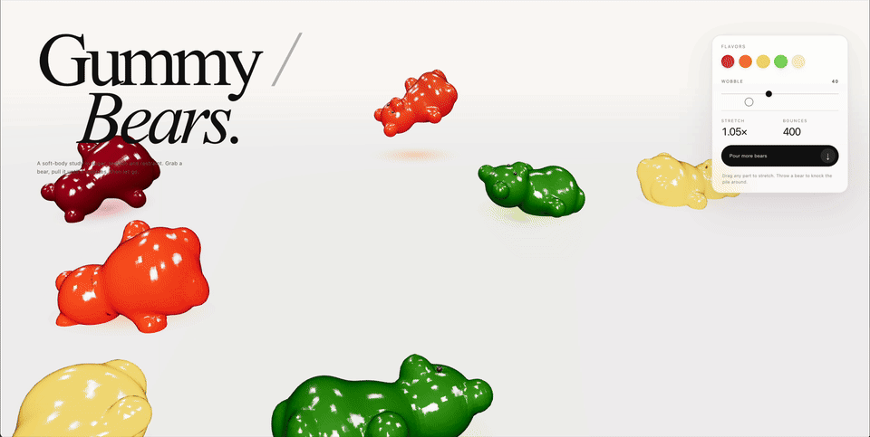

# Gummy Bears — one prompt, one shot

Produced by this recipe in a single request: the prompt in
[`prompt.txt`](prompt.txt), reasoning effort **Max**, `max_tokens` 196,608,
temperature 1.0 / top_p 1.0. No edits: [`gummy-bears.html`](gummy-bears.html)
is the answer exactly as the model wrote it (2,025 lines; three.js from a CDN
is the only dependency). Open it in a browser and grab a bear.

| | |
|---|---:|
| Prompt | 510 tokens, first token after 401 ms |
| Generated | **111,840 tokens in 2,407.7 s — 46.5 tok/s average** |
| Reasoning phase (~36 min, DSpark acceptance length ~3.3) | ~42.5 tok/s |
| Code phase (~4 min, acceptance length ~6.6 of 7) | **~80 tok/s, peaks at 92** |

[`demo.mp4`](demo.mp4) is a 45-second screen recording of the page.

